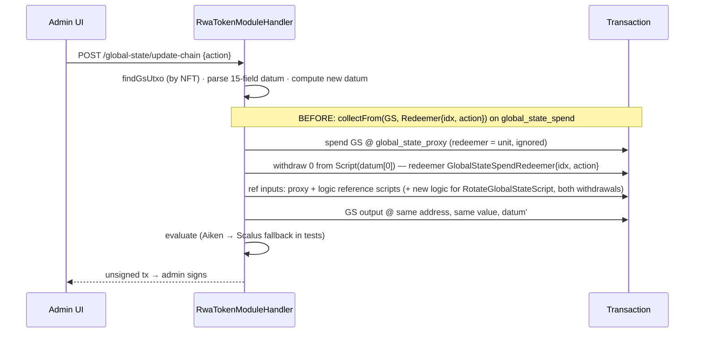

# RWA contract → cpt-rwa-ch-cmta-reference PR #29 (@346f9bf) + CIP-30 issuer signing — Implementation Plan

**Tier: R3** (validators, supply cap, irreversible admin actions on chain).
Gates: spec-reviewer → user approval → complexity-specialist on the GlobalState and cap invariants (WP-2/3/4) → build → verify → code-reviewer → user runs `/codex:adversarial-review` → staged.

## Goal
Every RWA flow builds transactions that the PR #29 validators accept. The flows are:
- register;
- genesis;
- mint and burn;
- transfer and third-party transfer;
- seize and denylist;
- member root;
- every GlobalState admin action, including `SetMintableAmount`, `RotateGlobalStateScript` and `LockUpgrades`.

The contract is pinned at `346f9bf61563494af0e7c8a914962c06da38afd0`. A trusted issuer can sign the 67-byte KYC claim in two ways:
- with a connected CIP-30 wallet (`signData`);
- by pasting a `signData` result (COSE_Sign1 + COSE_Key) produced in another wallet.

**Acceptance**
- `modules/rwa-token/plutus.json` is upstream's committed file at 346f9bf, byte for byte (sha256 `edd28650dd086e6d32b8a56317bb339ab415897aa8198ed5ed7b4b700ebc0009`, `verbatim_from_upstream: true`; this was reproduced locally with aiken v1.1.23+8949565). Checked by `ContractBlueprintPinTest`.
- `OfflineCip68EvalTest` evaluates each of these against the new scripts:
  - genesis;
  - registration (structural and with initial mint);
  - mint, burn, transfer with each KYC proof variant, seize, denylist add/remove, power-user add, member root;
  - every `GlobalStateSpendAction` constructor, each by a **named** eval. The ones that exist today (ModifySecurityInfo, SetRequiresSenderKyc, PauseTransfers, RotateAdmin, UpdateMemberRootHash, MintSecurity) are migrated. New ones are added in WP-3:
    - `addTrustedEntityEvaluates`, `removeTrustedEntityEvaluates`, `updateTrustedEntityEvaluates`;
    - `setRequiresReceiverKycEvaluates`;
    - `rotateMintingScriptEvaluates`;
    - `deactivateAfterPauseEvaluates`;
    - `lockUpgradesEvaluates`, plus `lockedRefusesSetMintableAmountRotateLogicAndRotateMinting` (WP-4).

    Each eval decodes the output datum and asserts that only the intended field index changed.
- Genesis registers the logic stake credential for the exact hash written in datum field 0, and that hash equals the derived logic (`genesisRegistersTheLogicNamedInField0`). Offline evals mock every reward account as registered, so they can't catch this.
- An admin action on a datum near the cap stays under the 16,384-byte tx limit (`adminActionNearCapFitsTxSize`).
- **Attestation:**
  - The backend accepts `{payloadHex, coseSign1Hex, coseKeyHex}`, checks the COSE signature off chain (unhashed and CIP-8 hashed), checks that the issuer is in `trusted_entity_vkeys`, and builds `Constr 1 [Constr 0 [protected_header, payload, hashed, signature, issuer_vkey]]`.
  - The PR's own `cip30-test-vectors.mjs` vectors pass in a Java unit test, unhashed and hashed.
  - A raw 64-byte signature is refused with a 400 that names CIP-30.
- **Frontend:**
  - The attestation panel offers "Sign with wallet" and a paste-COSE fallback. The raw-signature text and validation are gone.
  - **The admin page's "Issue KYC attestation" section** makes the full round trip, covered by `test-attestation-bundle.js`. It takes a holder address, tier and expiry, the issuer signs with their wallet, the backend verifies (`attestationVerifyEndpointAcceptsWalletBundle` / `…RejectsUntrustedIssuer`), and the section outputs a bundle. Pasted into the holder's transfer dialog, that bundle yields an accepted transfer. The parser rejects a bundle for another stake credential, another credential type, another policy (`/different token/`), another network, an expired claim, or an untrusted issuer. `resolvePastedAttestation` tests:
- a bundle pasted with no copied payload is accepted;
- a bundle whose tier and expiry differ from the modal defaults is sent unchanged;
- raw `{signature,key}` still requires the copied, unchanged claim;
- a recipient's bundle pasted into the sender field is rejected.
  - tsc, lint and `npm test` are green.
- **Admin:**
  - `SetMintableAmount` endpoint and UI section. The value must be absolute and lie in [0, 2^63−1]. It is refused once upgrades are locked. The platform never builds it alongside a mint; the contract rejects a hand-built one (`setMintableAmountWithMintRejectedOnChain`, a negative eval).
  - `RotateGlobalStateScript` endpoint and UI step, used to change the datum byte cap. It refuses unless the new logic's stake credential is registered and its reference script is published in an earlier, confirmed tx.
  - `PauseTransfers` to the current value is refused before building (F11).
  - A configurable `max_global_state_datum_bytes` at registration (default 8192, F09). It is the same value for mint and logic and must be > the genesis datum size.
- Offline Java suite and frontend suite are green; one live run on yaci-devkit covers genesis → register with initial mint → wallet attestation transfer → SetMintableAmount → rotate the logic to a new cap → mint.

**Non-goals**
- Keeping tokens registered under the old blueprint working. They are orphaned, and the status endpoint reports them INCOMPATIBLE.
- Changing the Aiken code, or following PR #29 commits after 346f9bf.
- Reading a GlobalState datum whose layout a *future* logic has reshaped. The platform reads core fields 0–4 by position and treats anything that isn't the 15-field v1 layout as INCOMPATIBLE.
- kyc / kyc-extended modules: different datum, untouched.

**Assumptions** (decided, not asked)
- The GlobalState output gets no stake credential, so it is at the shared proxy address. Every lookup goes by NFT (`findGsUtxo` already does), never by address.
- The issuer key is the COSE_Key `-2` value. The UI tells the issuer to pick the address whose payment key is the trusted vkey. If they pick another, the returned key won't be trusted and we fail before building.
- The CIP-30 issuer is an admin-side actor: whoever pastes or signs is not authenticated by the platform. The trusted-key check is the authorisation, as it is today.

## Global Constraints
- **Tests are immutable unless named here.** This upgrade deliberately changes the requirements encoded by these assertions, and you approve that by approving this plan:
  - `RwaCip171ProvenanceServiceTest`: the parameterisation count (10) and the param count (33).
    - The 1-arg `buildGlobalStateMintScript` and the 5-arg `resolveScripts` stay callable as `@Deprecated` compatibility overloads (default proxy hash and 8192 bytes), so the test's call sites (:44, :49) are not edited.
    - **No `src/main` code may call the overloads.** This is enforced by a grep proof command in WP-2, and by test `nonDefaultCapFlowsToMintLogicAndPlan` (cap 12288): GS mint param 3 == logic param 4 == the stored row's `max_datum_bytes`, and `planGenesis(...).globalStatePolicyId()` == the built GS policy. The repository URL assertion (:75, `…cpt-rwa-ch-de-cmta-reference`) is not edited: that name is upstream's README name and GitHub redirects it to the PR's repo.
  - `CmtaAttestationVerifierTest`: **rewritten**. All four tests (:61, :89, :103, :125) encode the raw-signature format and the 3-arg `CmtaAttestation`, which the contract no longer accepts. Each one gets a COSE equivalent that covers the same binding or rejection, so no case is dropped.
  - `test-cmta-attestation.js`: the `prepareCmtaSignature` raw-signature rules, and the `parseCmtaAttestationJson` bundle fields, where `signatureHex`/`issuerVkeyHex` become `coseSign1Hex`/`coseKeyHex`. The closing "legacy bundles remain valid" log string changes too. The subject, credential type, policy, network, expiry and trust checks stay as they are.
  - `test-review-root-tx.js`:
    - the 14-field fixture, and indices 3/8/11, which become 2/10/13;
    - the single spend redeemer becomes spend plus reward redeemer;
    - the tx body gains withdrawals (field 5).
  - `OfflineCip68EvalTest`: **no edits; additive only.** Its evals build through the handler, and its 4 positional `GsChangeSpec(...)` calls (:1043/1116/1195/1199) are kept working by a 13-arg compatibility constructor. If an existing eval turns out to need an extra stage submitted (e.g. `rwaTokenChain` at :2624-2653 or `DevnetRwaTokenPathsTest:419-426`), I stop and ask you before editing it.

  Each such change is listed as a hunk in its WP log. No other test may be edited.
- Every builder change must pass `OfflineCip68EvalTest` with the real compiled scripts. "It compiles" is not done.
- The Aiken evaluator wrongly rejects some transactions the ledger accepts: unused reference scripts come back as `RequiredRedeemersMismatch extra` (vault REF, 2026-10-06). Tests that hit it use the existing Scalus fallback and assert the Aiken reason. Contract guards are never weakened to dodge it.
- Never on `main`. End state is staged on `feat/update-rwa-contract`.

---

## Summary
PR #29 changes the shape of the RWA module in three ways:
- **GlobalState moves behind a proxy.** It now sits at an unparameterised, shared `global_state_proxy`. Every spend must also withdraw from `global_state_logic`, the logic named in datum field 0, carrying `GlobalStateSpendRedeemer`.
- **The datum is reordered.** It has 15 fields: a frozen core (logic hash, deactivated, admin, power-users policy, minting authority) followed by the rest.
- **The authority gets new parameters.** `minting_authority` drops `reference_asset_name` and takes the transfer and third-party hashes (F08).

It also adds `SetMintableAmount` (13) and `RotateGlobalStateScript` (14), an aggregate datum byte cap (F09), and the no-op pause guard (F11). It replaces the raw-signature `KycProof` with `Cip30Attestation`, and the constructor indices swap: Membership 1→0, attestation 0→1.

Nearly all platform work is in `RwaTokenModuleHandler` (8.7k lines) and `RwaTokenScriptBuilderService`. Three things change there:
- every GlobalState spend gets a second witness (the logic withdrawal);
- every datum index moves;
- the attestation path learns COSE.

For COSE, the platform already has a complete verifier for API auth (`RwaTokenAdminRequestVerifier`). We extract its parser instead of writing a second one.

Prior work on `feat/allow-mintable-amount-update` targeted an older contract version: no proxy, NFT-moving migration, `extensions` field. We port its UI pieces and its "reference script verified at use" idea. Its migration code is not ported, because the mechanism no longer exists.

## Diagram — a GlobalState admin action, before vs after



## Change map

```
src/programmable-tokens-offchain-java/src/main/
  resources/
    modules/rwa-token/plutus.json                  replaced  (upstream verbatim @346f9bf)
    contracts-pin.json                             ~15   new commit/sha, verbatim=true
    cip171-rebuild-receipt.json                    ~3
    db/migration/V34__rwa_gs_logic.sql             +6    ⚠ schema: rwa_token_registration.gs_logics TEXT (JSON logic registry), max_gs_datum_bytes INT
  java/.../service/
    RwaTokenScriptBuilderService.java              ~150  proxy + logic builders, new GS-mint/authority params
    RwaCip171ProvenanceService.java                ~20   CMTA_TITLES
    module/RwaTokenModuleHandler.java              ~900  ⚠ datum layout; GS spend → proxy+withdraw; new actions; attestation proof
    module/CmtaAttestationVerifier.java            ~120  COSE check replaces raw Ed25519
    cose/CoseSign1.java                            +140  extracted from RwaTokenAdminRequestVerifier (shared)
    RwaTokenAdminRequestVerifier.java              ~-90  uses CoseSign1 (behaviour unchanged, its tests pin it)
  java/.../model/CmtaAttestation.java              ~6    ⚠ public API: coseSign1Hex, coseKeyHex replace signatureHex
  java/.../controller/RwaTokenController.java      +40   ⚠ public API: publish-gs-logic, set-mintable-amount, rotate-gs-logic (+register), contract-status
  java/.../entity/RwaTokenRegistrationEntity.java  +12
src/programmable-tokens-offchain-java/src/test/
  .../offline/OfflineCip68EvalTest.java            ~+400 new evals (additive only, no edits)
  .../service/cose/CoseSign1Test.java              +80   PR vectors
  .../service/module/CmtaAttestationVerifierTest   +90
src/programmable-tokens-frontend/
  lib/rwa/attestation.ts                           ~80   build claim unchanged; COSE prepare + wallet sign
  lib/rwa/cose.ts                                  +70   cbor-based COSE_Sign1/Key split (display + precheck only)
  components/transfer/TransferModal.tsx            ~120  "Sign with wallet" + paste COSE
  lib/rwa/review-root-tx.ts                        ~10   new indices
  lib/rwa/mintable-amount.ts                       +41   ported
  components/admin/GlobalStateSection.tsx          ~120  SetMintableAmount, rotate logic (cap), pause no-op disable
  components/register/steps/... (rwa flow)         ~20   datum byte cap field
  types/api.ts                                     ~10
  test-cmta-attestation.js, test-review-root-tx.js, test-mintable-amount.js (named edits / new)
docs/CONTRACTS.md                                  ~30
```

## Risk table

| # | Change | Risk | Why | Review this |
|---|---|---|---|---|
| 1 | Datum layout constants + every `replaceGsField` / reader | High | A wrong index silently rewrites the wrong field (e.g. pause vs cap). The validator would reject most, but not all, mistakes. | Line by line against `GlobalStateDatum` |
| 2 | GlobalState spend → proxy + logic withdrawal, all builders incl. mint/burn | High | It is the only path to supply changes. Wrong redeemer placement fails closed, but index drift after balancing does not always. | Line by line; check the evals assert the output index |
| 3 | `RotateGlobalStateScript` | High | The chain trusts whatever field 0 names afterwards. A target not derived from the token's own parameters can hand GlobalState to a permissive script, permanently once locked (see Addendum I4). An unregistered or unpublished target just fails the tx. | Line by line + complexity-specialist |
| 4 | `max_global_state_datum_bytes` at registration | High | A cap below what later writes need refuses growth until a rotation. LockUpgrades then makes that permanent. | Read the precheck and default |
| 5 | V34 migration | High | Schema change, not reversible in place | Line by line |
| 6 | COSE extraction + off-chain check | Medium | Fails closed on chain. A bug off chain means a confusing UX or an accepted-then-rejected tx, not lost funds. Shared with auth, whose tests pin it. | Read parser; trust vectors |
| 7 | KycProof constructor swap | Medium | Index 0/1 swap. The evals catch it. | Skim + eval |
| 8 | `SetMintableAmount` | Medium | Admin power over the cap. The contract guards it; the platform only builds. | Read prechecks |
| 9 | Frontend wallet sign + paste | Low | UX; no keys handled | Skim |
| 10 | Blueprint/pin/provenance files | Low | Byte-verified by test | Trust test |

---

## Tasks (work packages in `docs/work/`)

### WP-1 — The platform serves the PR #29 blueprint and its provenance verifies
Check: `ContractBlueprintPinTest`, `RwaCip171ProvenanceServiceTest` green. → `docs/work/wp-1-pin-blueprint.md`

### WP-2 — Genesis and registration build valid txs with proxy + logic and the 15-field datum
Check: `OfflineCip68EvalTest` genesis + both registration shapes evaluate. A new test proves a genesis with `maxGsDatumBytes` below the datum size is refused before building. → `docs/work/wp-2-genesis-layout.md`

### WP-3 — Every GlobalState spend (all 13 pre-existing actions, mint, burn, member root) goes through proxy + logic withdrawal
Check: `OfflineCip68EvalTest` GlobalState-action loop covers the old 13 constructors, plus mint/burn/member root evals. → `docs/work/wp-3-gs-spend-proxy.md`

### WP-4 — Admins can set the mintable amount and rotate the GS logic to a new datum cap; no-op pause is refused
Check: new evals `setMintableAmountEvaluates`, `setMintableAmountRefusedWhenLocked`, `rotateGsLogicToNewCapThenMintEvaluates`, `rotateGsLogicRefusedUntilNewLogicRegisteredAndPublished`, `pauseToCurrentValueRefusedBeforeBuild`. → `docs/work/wp-4-cap-and-rotation.md`

### WP-5a — COSE signData results are parsed and verified off chain, shared with API auth
Check: `CoseSign1Test` (PR vectors, both modes) and `CmtaAttestationVerifierTest` (rewritten) green; `RwaTokenAdminRequestVerifierTest` unchanged and green. → `docs/work/wp-5a-cose-verifier.md`

### WP-5b — Transfers carry a Cip30Attestation proof; raw signatures are refused with a clear error
Check: evals `transferWithCip30AttestationEvaluates` and `transferWithHashedCip30AttestationEvaluates`, plus `rawSignatureAttestationRefused400`. → `docs/work/wp-5b-cip30-transfer-proof.md`

### WP-6 — The frontend signs claims with the issuer's wallet or accepts a pasted signData result, and drives the new admin actions
Check: `npm test` (incl. new `test-cose.js`, ported `test-mintable-amount.js`), `npx tsc --noEmit`, `npm run lint`. → `docs/work/wp-6-frontend.md`

### WP-7 — End-to-end on yaci-devkit
Check: scripted run of the acceptance sequence, with tx hashes recorded in the WP log. → `docs/work/wp-7-e2e.md`

Order:
- **WP-1 + WP-2 + WP-3 are one landing, verified as a unit.** WP-1 doesn't compile alone, and after WP-2 the old GS spend script is gone, so existing evals fail until WP-3. WP-2's green run is limited to its named tests; the full suite is the gate at the end of WP-3. Then WP-4 → WP-5b.
- WP-5a runs in parallel from the start. It owns only `service/cose/**`, `CmtaAttestationVerifier`, `RwaTokenAdminRequestVerifier`, `model/CmtaAttestation.java` and their tests. No other WP touches these files.
- WP-6 starts once the WP-4 and WP-5b APIs are fixed. WP-7 is last.
- WP-2, WP-3, WP-4 and WP-5b share `RwaTokenModuleHandler` and `offline/**`, so the orchestrator builds them in sequence.
- V34 belongs to WP-2 alone and is frozen there with every column and table later WPs need. WP-4 adds no migration.

## Detail

**Datum layout (WP-2).**
- Replace the index constants with the v1 layout: 0 logic, 1 deactivated, 2 admin, 3 PU policy, 4 authority, 5 paused, 6 mintable, 7 denylist policy, 8 security_info, 9 trusted vkeys, 10 member root, 11 sender KYC, 12 receiver KYC, 13 network, 14 locked.
- `parseGsFields` requires constructor 0 and exactly 15 fields. Whether field 0 is known is decided by the logic registry (below), not by the parser.
- Genesis checks off chain, mirroring the guide:
  - field 0 is 28 bytes and ≠ admin, authority and proxy;
  - the list policy IDs are distinct and equal the compiled list mint hashes;
  - the serialised datum is smaller than the cap, with a headroom of ≥ 1024 bytes (a platform rule).

**Parameters (WP-2).**
- `global_state_mint(tx0, index0, proxy_hash, max_bytes)`.
- `global_state_logic(security_asset_name, issuance_policy_id, gs_policy_id, pu_list_script_hash, max_bytes)`.
- `minting_authority(…, pu_list_script_hash, transfer_hash, third_party_hash)`, with `reference_asset_name` removed.
- `resolveScripts` order: proxy-mint, issuance, PU spend, denylist spend, transfer, third-party, authority, GS proxy, GS logic. There is no new cycle: the logic doesn't take the authority.
- The per-token `max_bytes` is stored. The logic's hash depends on it, so it cannot be re-derived from defaults.

**Registration (WP-2).**
- Register the logic stake credential in the genesis tx, alongside the authority and proxy registrations already there.
- **The creation chain keeps its shape.** No transaction is added, CIP-171 stays at indices 2/3, and `InitialMintTransactionValidator`, `ChainBuildResult` and the frontend creation flow are untouched.
  - **Minting path:** the existing publishScripts slot (`RwaTokenModuleHandler.java:4973-4985`) publishes the authority (9.3 kB) and the GS **logic** (5.7 kB) where it used to publish the authority and `globalStateSpend`. Test `publishScriptsTxFitsSizeLimit` asserts the serialised tx is ≤ 15,872 bytes (16,384 − 512 margin). The logic row is written from this tx.
  - **Structural path:** unchanged, with no publish tx (`OfflineCip68EvalTest:1489` still holds). The logic reference script is published by **`POST /rwa-token/{policyId}/publish-gs-logic`**, a standalone admin-paid tx outside the creation chain and an **explicit** UI step. Nothing is prepended implicitly, because the frontend assumes one tx per change: RotateAdmin, `runChain` labels, MintSection.
    - `buildGlobalStateUpdateChain` and member root refuse with "publish the GlobalState logic first".
    - Mint and burn keep their existing "authority reference script missing" refusal (:1519-1529, :5566-5581), which fires first. Publishing the logic alone doesn't unblock minting, so its message is not shown there.
    - The same endpoint is rotation step 2.
  - **The proxy (424 B) is never published.** It is attached inline to every GS spend.
  - The admin pays the min-UTxO for the logic reference script (≈25 ADA) at the first GS write on structural tokens. The UI says so before signing.
- If `InitialMintTransactionValidator` turns out to pin the *set* of published script hashes, the `globalStateSpend` → logic swap must be reflected there. That file is in WP-2's allowed list for that case only.
- Registry node fields 3/4 = the authority's transfer and third-party hashes (F08). The platform already passes these, and the eval asserts it.

**Logic registry (WP-2, used by WP-3/4).**
- The registry is a JSON column `gs_logics` (TEXT) on `rwa_token_registration`, **not a new table or repository**. The handler's constructor is called positionally by `OfflineCip68EvalTest:2419-2471` and `DevnetRwaTokenPathsTest:360`, so a new repository would force test edits. The registration entity already flows through the tests' stubbed registration repository.
- Each entry has `logic_hash`, `max_datum_bytes`, `script_cbor` (applied bytes), `ref_tx_hash`, `ref_output_index`, `ref_state` (PENDING | CONFIRMED), `registration_tx_hash` and `registration_state`. The JSON is (de)serialised by a small value class.
- Rotations are rare, admin-serialised writes, so a list column is enough.
- Genesis writes the v1 entry. A rotation's register and publish steps write the new entry.
- After the swap, `gs_spend_ref_index` and `ref_scripts_tx_hash` mean "the logic's output index in the publishScripts tx" and "that tx's hash". On the minting path the v1 entry's ref is set from them. The old mint/burn guard on `getGsSpendRefIndex()` is replaced by the entry lookup.
- **Ordinary writes accept a PENDING entry** and resolve the ref UTxO. Registration-with-mint spends GS against a publish tx in the same chain that hasn't been submitted yet. Only rotation step 3 and a publish rebuild require CONFIRMED. (De)serialisation stays inside `GsLogicEntry`, with no separate JPA converter file.
- `publish-gs-logic` retries:
  - an entry in PENDING state is re-checked on chain before a new publish is built;
  - a rebuild is allowed only after the pending tx's TTL has passed and it is still absent;
  - a reference that later lands is never overwritten.
- **Every GS write path looks up input field 0 in this table.** If the hash is absent, the build is refused with "UNKNOWN GlobalState logic <hash>: rotated outside this platform". The row supplies the reference input, the cap for prechecks, and the bytes. `resolveScripts` derives only v1, for genesis.
- The same lookup refuses old-blueprint tokens in every builder: their GS isn't at the proxy, has 14 fields and has no row.

**Write-path size precheck (WP-3).** Before building, the platform refuses an action whose output datum is larger than both the row's cap and the input datum's size. This mirrors `datum_within_cap` and gives a readable error in place of an opaque eval failure. It covers AddTrustedEntity, ModifySecurityInfo, member root (empty → 32 bytes) and burns.

**GlobalState spend (WP-3).**
- One helper, `attachGsSpend(builder, gsUtxo, logicHash, actionData)`:
  - spends with `ConstrPlutusData(0,[])`;
  - adds `withdraw(rewardAddress(Script logicHash), currentRewardBalance)` with `ConstrPlutusData(0, [outIdx, action])`;
  - attaches the logic reference input (from the field-0 row) and the proxy inline.
- `global_state_output_index` is recomputed after balancing, the same way the code does today (output pinned at index 0).
- The logic hash is read **from input datum field 0**, never from the derived default. This keeps working after a rotation.
- Call sites to replace:
  - `buildSingleGsUpdateTx`;
  - the mint (1612–1673) and burn (5710–5888) flows;
  - member root (6513–6542);
  - registration-with-mint (1002–1154).
- Other hard-coded layouts and call sites:
  - `RwaTokenAllowlistService.java:184-185` has a hard-coded `size != 14` and `.get(8)`. These become 15 and 10. A test covers the allowlist read of member root.
  - `buildMembershipProof` (2323–2340), used by the mint and burn destinations: KycProof Constr 1 → 0.

**Cap and rotation (WP-4).**
- `SetMintableAmount{n}` goes through `GsChangeSpec`, with prechecks:
  - admin present;
  - `!locked`;
  - n in range;
  - not the same as the current value.
- Rotating to a new cap is three steps, each its own admin-signed tx:
  1. Register the new logic's stake credential. The new logic is applied with the token's own `security_asset_name`, `issuance_policy_id`, `global_state_policy_id` and `pu_list_script_hash`, plus the new cap. Test: `rotationStep1RegistersExactlyTheNewHash`.
  2. Publish its reference script. This writes the new row.
  3. Rotate. Both withdrawals carry `RotateGlobalStateScript{new}`, each withdraws its full balance, both reference scripts are attached, and no security token moves.
- Step 3 is refused before build unless:
  - steps 1 and 2 are confirmed on chain;
  - the new hash ≠ admin, authority and current logic;
  - **the current datum + 1024 bytes ≤ the new cap.** On chain, the cap check can't catch a too-small cap during rotation, because the output is the same size as the input. This precheck is the only guard.
- Test `rotateToSmallCapRefusesGrowingWriteButAllowsSameSize`. It rotates to a cap just above the current size (allowed only by a test-only override of the headroom rule), then checks that a growing write is refused before build and a same-size write evaluates.
- Rotating back to the old logic uses its stored row, so no re-derivation is needed.
- CIP-171 provenance is not recorded for a rotated-in logic. It is the same audited code with a different cap parameter. This is listed under Skipped.
- Contract status shows on-chain field 0 vs the derived logic hash, plus the cap and the locked flag. We port the read-only status idea from the earlier branch, not its 961-line handler diff.

**Attestation (WP-5).**
- `CoseSign1.parse(hex)` handles optional tag 18 and the protected bstr bytes (taken verbatim). It reads the unprotected `hashed`, the payload (which may be nil) and a 64-byte signature. `CoseKey.vkey(hex)` reads label -2, which must be 32 bytes.
- Verifier steps:
  1. the claim checks that already exist;
  2. if hashed, COSE payload == blake2b_224(claim), or nil; otherwise COSE payload == claim, or nil;
  3. protected header is 1–255 bytes;
  4. Ed25519 verify over `["Signature1", ph, h'', claim | hash]`;
  5. the issuer key is trusted.
- The proof uses our claim, never COSE_Sign1[2].

**Frontend (WP-6).**
- **The issuer wallet is a separate session.** TransferModal's `useWallet()` belongs to the sender, who later calls `signTx`.
  - The issuer picks a wallet from the installed `window.cardano` entries. We call that wallet's own `enable()`, keep the API handle locally in the attestation panel, and never write it into the wallet context.
  - The issuer picks one of `getUsedAddresses()`. We call `signData(addrHex, claimHex)` and send `{payloadHex, coseSign1Hex: signature, coseKeyHex: key}`.
  - If the issuer and the sender use the same browser wallet with different accounts, the panel tells the issuer to switch the account back before the sender signs.
- **"Issue KYC attestation" section on the rwa-token admin page (`app/admin/rwa-token/[policyId]`)** (added 2026-10-15 at your request).
- **Inputs:** the holder's base address, tier (1–3), and expiry (date/time, at least 2 minutes ahead; default +30 days). The policy ID and network come from the page and the live config, not from the user.
- **Claim:** built with the existing `buildCmtaAttestationPayloadHex`. The section shows a decoded preview before signing: stake credential, credential type, tier, expiry, policy, network.
- **Signing:** through the shared `IssuerSigner` component, also used in TransferModal. It is a separate `window.cardano[name].enable()` session plus an address picker, then `signData`. The returned COSE_Key vkey must be in the token's live `trusted_entity_vkeys`; if it isn't, the section says which key signed and that it isn't trusted, and produces no bundle.
- **Backend check:** before showing the bundle, the section calls `POST /rwa-token/{policyId}/attestation/verify`. That endpoint runs the WP-5a verifier against the live GlobalState, so the admin only ever shares a bundle the backend would accept.
- **Output:** a copy-paste bundle, `{"v":1,"payloadHex","coseSign1Hex","coseKeyHex"}`, as compact JSON. It has a Copy button and a "valid until" line. Nothing is stored server-side.
- **The holder's side:** the transfer dialog's paste field accepts this bundle, as well as the raw `{signature,key}` from another wallet's signData. `parseCmtaAttestationJson` is updated to the COSE fields. It checks:
  - the subject equals the sender's (or recipient's) stake credential and credential type;
  - the policy, network and expiry;
  - the issuer is trusted.
- **Holder-side data flow (TransferModal).** One `lib/rwa` function, `resolvePastedAttestation(text, party, ctx)`, decides between the two paste formats.
  - **Bundle** (`{"v":1,…}`, where `v` must be 1):
    - the bundle's `payloadHex` IS the claim, checked by `parseCmtaAttestationJson` against that party's address (sender or recipient), the policy, and the live network and trusted vkeys;
    - the browser also checks that the COSE_Sign1 payload, if not nil, equals the claim, or `blake2b_224(claim)` when hashed;
    - the modal's tier and expiry inputs are filled from the bundle and locked while it is present;
    - submit sends the bundle's `{payloadHex, coseSign1Hex, coseKeyHex}` **without rebuilding the claim**, so no copied payload is needed.
  - **Raw `{signature,key}`** from another wallet keeps today's rule: the copied, unchanged claim is required.
  - `freshSignatureAttestation` and `parsePastedSignature` route through this function.
- **What the bundle reveals:** it is bound to one holder credential, one token, one network and an expiry, so a leaked bundle lets nobody else transfer. It does reveal that the holder is KYC'd at that tier, so the UI labels it "share only with the holder".

**Explicit "Publish GlobalState logic (≈25 ADA)" step.** It appears in GlobalStateSection and on the members page whenever the backend refuses with "publish the GlobalState logic first". It states the min-UTxO cost before signing and calls `publish-gs-logic`.

**Member-root signing gate (`lib/rwa/review-root-tx.ts`).** This must be redesigned, because it would refuse every new member-root tx. New rules:
  - body fields: allow 5 (withdrawals);
  - exactly one spend redeemer, on the GS input, whose data is ignored;
  - exactly one withdrawal, whose credential == live datum field 0 and whose amount == the live reward balance;
  - exactly one reward redeemer `Constr0[outIdx, Constr8[root]]`;
  - live datum has 15 fields, read at indices 2/10/13.

  Negative tests: a withdrawal to a foreign credential, an extra withdrawal, the action placed on the spend redeemer, a missing withdrawal.
- The `rotate-admin.ts` comment is updated to cite `global_state_logic.ak`. Its logic scans all redeemers, so it already handles the reward redeemer; a test asserts this.
- Paste mode takes the JSON `{signature, key}` or the two hex fields.
- Precheck in the browser: the vkey from COSE_Key is in the token's trusted vkeys, and, for the raw `{signature,key}` path only, the claim hasn't changed since signing (existing rule; a bundle carries its own claim).
- The Ledger hashed-mode warning text is shown when `hashed` is true.

## Addendum — invariants from the complexity-specialist review (2026-10-15)

Decided with the user on 2026-10-15. This section supersedes earlier text where they conflict.

**Correction.** An unregistered or unpublished rotation target does not brick GlobalState: the rotation tx simply fails as a whole (ledger phase 1, `global_state_logic.ak:302`). The real rotation hazard is a target that wasn't derived from the token's own parameters. The chain trusts whatever logic field 0 names afterwards.

| # | Invariant | WP | Test |
|---|---|---|---|
| I1 | Size is measured on the canonical Plutus re-encoding (`serialise_data`: indefinite lists and constructor fields, chunked >64 B bytestrings), never on the source bytes | WP-2 | `canonicalSizeMatchesOnChainAtCapBoundary` (definite-encoded input datum at cap and cap+1) |
| I2 | Cap bound: `genesis/current datum + 1024 ≤ cap ≤ 8192` (user decision: fixed maximum 8192). A token registered at 8192 can therefore only rotate to a SMALLER cap; the UI says so | WP-2, WP-4 | `capAbove8192Refused`, `mintAndBurnAtCap8192FitTxSize` |
| I3 | Burn reserve: an admin write that grows the datum is refused if `out > cap − 64`. MintSecurity only mirrors the chain rule | WP-3 | `growingAdminWriteRefusedInsideBurnReserve`, `burnStillBuildsAtCapMinusReserve` |
| I4 | Rotation target = `hash(apply(pinned logic, the token's own asset name / issuance policy / GS policy / PU list hash, newCap))`. It must also equal the row's hash, `hash(row.script_cbor)` and the ref UTxO's scriptRef hash. Endpoints accept only `newCap` | WP-4 | `rotateRefusesRowNotDerivedFromTokenParams` |
| I5 | Every use of a registry row re-verifies its bytes and cap against that derivation | WP-3 | `tamperedLogicRowRefused` |
| I6 | RotateMintingScript accepts ONLY this token's derived authority (user decision). GlobalStateSection's paste field becomes "rotate to latest authority" | WP-3, WP-6 | `rotateMintingScriptRefusesNonDerivedHash` |
| I7 | The admin is always a key: RotateAdmin and genesis refuse any known deployment script hash, and the new admin is a required signer | WP-3 | `rotateAdminRefusesScriptHash` |
| I8 | Withdrawals use the live reward balance (queried), not 0, for the GS logic, plus every withdraw-0 script in GS txs | WP-3 | `gsLogicWithdrawsLiveRewardBalance` |
| I9 | Reference script ref resolved live at build: it exists, is unspent and its scriptRef hash equals field 0. If spent, the row becomes SPENT and republish is allowed (an exception to "never overwritten") | WP-3 | `spentLogicRefAllowsRepublish` |
| I10 | The GS logic reference script is locked at an always-fail native-script address (user decision). The ≈25 ADA is locked permanently, and the UI says so | WP-2, WP-3 | `gsLogicRefOutputIsUnspendable` |
| I11 | PENDING rows store the publish tx's TTL slot. A row past its TTL and absent from chain becomes ABSENT. PENDING is accepted only within TTL or inside its own creation chain, never for rotation step 3, LockUpgrades or as a rotation target | WP-3 | `expiredPendingLogicRowTreatedAbsent` |
| I12 | Stake registration step 1 is idempotent. "Already registered" means any registration cert type on chain | WP-4 | `rotationStep1IdempotentWhenAlreadyRegistered` |
| I13 | `@Version` optimistic locking on `RwaTokenRegistrationEntity`, so a lost update can't drop a `gs_logics` row | WP-2 | `concurrentGsLogicsUpdateFails` |
| I14 | SetMintableAmount also requires `n + circulating supply ≤ 2^63−1`. The UI shows supply and "max total = supply + n" | WP-4, WP-6 | `setMintableAmountRefusesInt64Overflow` |
| I15 | Rotate*, SetMintableAmount, LockUpgrades and registry operations are never batched together in one update-chain request. Rotation and lock are standalone endpoints | WP-4 | `rotateAndLockNeverBatched` |
| I16 | Pre-lock checks: field-0 row verified (I5), ref CONFIRMED, credential registered; field-4 authority == derived, and registered; datum + 64 ≤ cap; a warning below 1024 B of headroom; no pending rotation; a typed confirmation in the UI | WP-4, WP-6 | `lockRefusedWhileRotationPending`, `lockRefusedWhenAuthorityNotDerived` |
| I17 | Server-side self-check (user decision: ALL GS txs) on the final balanced tx, before it is returned. It requires exactly the GS input and one GS output at the same address with the same non-ADA value and no ref script; a datum differing in exactly the intended field(s) and value(s); the intended redeemer constructor, arguments and output index; withdrawals = {field-0 logic} (+ new logic for rotation, both `Rotate{new}`) plus only the expected protocol withdrawals for mint and burn; no certificates; no unexpected mint, script input or purpose; and exactly the expected required signers | WP-3 (verifier), applied in WP-3/4 | `GsTxSelfCheckTest` (one negative case per clause) |

**Resolutions (addendum spec review, 2026-10-15).** These take precedence over the table rows they refine.
- **R1 (I6).** The derived-authority-only rule plus the existing no-op guard means a platform-created token can never rotate its authority. That is intended: the action exists for recovery. `rotateMintingScriptEvaluates` therefore seeds, additively in the offline chain, a GS whose field 4 differs from the derived hash, then rotates back to the derived one. The no-op refusal stays. WP-6 disables "rotate to latest authority" when field 4 already equals the derived hash.
- **R2 (I9 vs I11).** The live check decides; there is no "within TTL" acceptance.
  - A row whose ref UTxO is found live, unspent and with the right scriptRef hash is promoted to CONFIRMED.
  - A standalone write against a PENDING row whose ref is not yet visible is refused: "the GlobalState logic publish tx has not confirmed yet".
  - Only the creation chain spends against PENDING, through the hybrid supplier that holds its own publish output.
  - The TTL decides only republishing: a PENDING row past its TTL and absent from chain becomes ABSENT and may be republished. A CONFIRMED ref that disappears becomes SPENT and may be republished.
  - `publishGsLogicThenAdminActionEvaluates` submits the publish tx to the offline chain first, so the ref is live.
- **R3 (data sources, I8/I11/I14).** New methods on `service/UtxoProvider.java`: `Optional<BigInteger> rewardBalance(String stakeAddress)`, `Optional<BigInteger> assetSupply(String policyId, String assetNameHex)` and the tip via the existing `currentTipSlot()`. Fallbacks when a method returns empty (as an unstubbed Mockito mock does):
  - reward balance → 0, with a WARN, which is today's behaviour;
  - tip slot → the PENDING row stays PENDING, so no republish;
  - supply → SetMintableAmount is refused ("cannot confirm circulating supply"). It is a new action, so no existing eval depends on it.

  The new tests stub non-zero values with `when(utxoProvider.rewardBalance(...))`. `UtxoProvider.java` joins the WP-3 and WP-4 allowed lists.
- **R4 (I13).** V34 adds `version BIGINT NOT NULL DEFAULT 0`, and the entity gets `@Version`. `concurrentGsLogicsUpdateFails` is a `@DataJpaTest` at `src/test/.../service/RwaTokenRegistrationVersionTest.java` (WP-2).
- **R5 (I15).** LockUpgrades moves to `POST /rwa-token/{policyId}/lock-upgrades`, which runs the I16 pre-lock checks. update-chain refuses LockUpgrades and RotateGlobalStateScript outright, naming the endpoint. `lockUpgradesEvaluates` moves to WP-4, and WP-6 points the lock button at the new endpoint.
- **R6 (I17 ownership).** `GsTxSelfCheck.java` and its test go into WP-4's allowed list as well. WP-3 delivers the verifier with clauses for the existing actions; WP-4 adds the SetMintableAmount, rotation (two `Rotate{new}` withdrawals) and lock clauses, each with a negative case.
- **Definitions.** "Pending rotation" (I16) means a registry row that was **never installed** (`installedTxHash == null`) and whose registration or ref is still PENDING, i.e. in flight. `installedTxHash` is written at genesis (v1) and by rotation step 3, and it stays set after a rotation away. A never-installed row that is CONFIRMED is only a pre-lock WARNING ("rotation target X was prepared but never installed"), not a refusal. Test: `lockAllowedAfterCompletedRotation`. (Re-review fix.)
- **R2 refinement.** A CONFIRMED ref becomes SPENT only when the backend affirmatively reports the output spent, never on an empty `Optional` (indexer lag would otherwise cost ≈25 ADA for a needless republish). With I10 the ref is unspendable, so in practice this never fires.
- **R3 refinements.** The tip slot reuses the existing `UtxoProvider.currentTipSlot()`. `assetSupply` sums the security asset over `findUtxosByPolicy` (the local index), so it also answers on yaci-devkit for WP-7. The minting-path creation flow shows no "locked permanently" note (the creation UI is unchanged by decision). The publishScripts doc comment is corrected to say the logic output is unrecoverable. `buildGlobalStateLogicScript(…, maxBytes)` is already public, which I5 needs.

Not adopted: a client-side review gate covering SetMintableAmount, Rotate*, Lock and Deactivate (it would expand WP-6; I17 covers it server-side). An offline MintSecurity dry-run under the new logic before step 3 is RECOMMENDED and done when cheap.

## The two decisions most likely to be wrong
1. **The platform writes only through logics in its own `gs_logics` registry, and reads only the v1 layout.** It refuses an unknown field-0 hash (UNKNOWN LOGIC). Today the only rotation it can make is a v1 logic with a different cap, so it always maps. A future upstream logic would need a platform release. The alternative, reading the core by position and keeping the rest opaque, keeps reads working but makes every write unsafe.
2. **The GlobalState output gets no stake credential (it sits at the shared proxy address).** Lookups already go by NFT. If any code path scans by address (the researcher listed per-tx address derivations at 1673/1733/5885/…), it would see other tokens' GlobalStates. WP-3 must show those are output addresses, not lookups. The alternative is a per-token stake credential, which gives a unique and stable address because the logic keeps the address on every update.

## Assumed / Unsure / Skipped
**Assumed**
- That PR #29 at 346f9bf is what you want even though it is unmerged. The pin records the PR head commit, and the provenance tests only hash bytes, so they don't need it reachable from upstream main.
- yaci-devkit is available for WP-7.

**Unsure** (most likely wrong first)
1. Whether the Aiken evaluator rejects the rotation tx: there are two logic withdrawals and possibly an unused reference script. If it does, WP-4's rotation eval needs the Scalus fallback, and production falls back to Blockfrost then a ceiling budget.
2. The minting-path publishScripts tx carries 14,976 bytes of scripts under a 16,384 limit. `publishScriptsTxFitsSizeLimit` decides it. If it fails, the logic moves to the standalone `publish-gs-logic` tx on that path too. That is a design change and would come back to you.
3. Whether the deprecation check needs a build change. No build file sets `-Xlint` today, so it runs through a scratch Gradle `--init-script` that adds `-Xlint:deprecation`. No `build.gradle` edit is made.
4. Which CIP-30 wallets return a nil payload or tag 18. The parser handles both, but only the PR vectors and the auth tests' wallet captures are real samples.

**Skipped**
- Migrating existing tokens (your decision).
- CIP-171 provenance for a rotated-in logic. It is the same compiled code with a different cap.
- Publishing the proxy as a reference script at all. It is 424 B and attached inline.
- The canonical repo name in the on-chain CIP-171 record. It stays `-de-`, which redirects; `docs/CONTRACTS.md` notes the canonical `cpt-rwa-ch-cmta-reference`.
- The earlier branch's authority-rotation and registry-upgrade panel. Rotating the authority already exists as a GlobalState action. A cross-pin upgrade panel only matters on the next re-pin, and we're orphaning instead.
