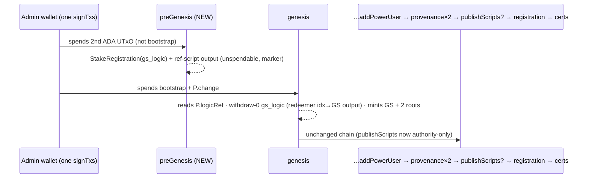

# RWA PR #29 follow-up: pin 63fad89 (genesis runs the GlobalState logic) — Implementation Plan

**Tier: R3** (validators / token-creation chain; changes every new token's policy id).
Builds on `2026-10-15-rwa-contract-pr29-upgrade.md` (its Addendum I1–I17 and decisions stay in force).
Base: the staged tree on `feat/update-rwa-contract` (HEAD 403f48c + staged PR #29 @346f9bf work).

## Goal
The platform serves upstream PR #29 at head `63fad8917ebb6057105d833cafc601b9e4c78ccb`, and every
new token's genesis runs the withdraw-0 of the GlobalState logic its datum names (field 0), as the
new `global_state_mint_validator` requires.

**Acceptance**
- `modules/rwa-token/plutus.json` is upstream 63fad89 verbatim (sha256 `12cd56fc23deb6ec5ee511bb39fd569da83f2af5d5cb29364d4d890a7ecc6425`,
  reproduced locally with aiken v1.1.23 — done); `contracts-pin.json`, `cip171-rebuild-receipt.json`
  and docs/CONTRACTS.md name 63fad89; `ContractBlueprintPinTest` and the CIP-171 verifier pass.
- The creation chain gains one transaction in FRONT of genesis ("preGenesis"), signed in the same
  single `signTxs` call: it registers the logic's stake credential (legacy StakeRegistration, no
  witness — the existing genesis practice) and publishes the logic as a reference script at the
  unspendable address with the usual marker. It never spends the bootstrap UTxO.
- Genesis no longer registers the logic credential; it spends the bootstrap + the preGenesis
  change, reads the preGenesis logic ref, and withdraws 0 from the logic with redeemer
  `GlobalStateSpendRedeemer { global_state_output_index = <GS output>, action = SetMintableAmount { <datum's own mintable_amount> } }`
  (action ignored on chain at genesis). Offline evals of the whole chain pass against the new blueprint.
- On the mint path `publishScripts` publishes only the minting authority; the v1 logic's
  `GsLogicEntry` points at the preGenesis output (PENDING + TTL), its registration at the preGenesis tx.
- `InitialMintTransactionValidator` accepts a chain whose first tx is preGenesis: preGenesis must
  not spend the bootstrap; genesis (next) must spend the bootstrap and a preGenesis output; the
  CIP-171 index checks are relative to genesis. A chain without preGenesis is still accepted only
  for already-frozen legacy rows (old pin) — new builds always produce it.
- Funding (user decision 2026-10-16, "Second UTxO"): `planGenesis` also selects preGenesis funding =
  eligible ADA-only UTxOs disjoint from genesis funding, ≥ 40 ADA total; reserved like genesis funding.
  A wallet without one is refused before any row is written: "send yourself a second ADA-only UTxO
  (≥ 40 ADA) and retry".
- Frontend signs/hashes/submits preGenesis first (types, `chainTxs`, `expectedHashes`).
- Full Java suite: same 22 pre-existing failures as base, nothing new; `ciTest` green; frontend tsc/lint clean.

**Non-goals**
- Tokens created at 346f9bf (devnet only) are orphaned: their field 0 is the old logic hash, which
  no longer derives (`gsWitness` refuses UNKNOWN LOGIC). Same decision as the original upgrade.
- No change to rotation: our builder already sends the identical `Constr 0 [0, Rotate{new}]` on
  both withdrawals, which is what the new outgoing check demands (verified by the existing rotation evals).
- No auto-split for single-UTxO wallets (user chose "Second UTxO").

**Assumptions**
- Ledger processes withdrawals against the pre-certificate state, so registration must be in an
  earlier tx (upstream guide §0 and our own existing comment agree).
- Four scripts inline = 2355+5756+5203+5945 = 19 259 B > 16 384, so the logic must be a reference
  script; the three mints stay inline (13.3 KB today, fits).
- A mempool-chained reference input + spent output from preGenesis resolves through the existing
  hybrid UTxO/script suppliers, as publishScripts → registration already does.

## Spec-review round 1 — resolutions (binding; supersede anything above that disagrees)
**R1 Recovery (`InitialMintAttestationStore` recovery/archive).** The "confirmed > 0 && bootstrap
unspent → UNKNOWN" contradiction rule applies to genesis and later txs only. preGenesis confirmed +
bootstrap unspent + tip ≤ genesis TTL → PARTIAL (resume submission). After every TTL (preGenesis and
genesis) has passed → EXPIRED_UNSTARTED with `canStartNewPolicy=true`. The expiry bound is
`max(ttl, genesisTtl, preGenesisTtl)`. Legacy BUILT chains (no preGenesis) keep the genesis-first reading.
Sunk cost of an abandoned attempt after preGenesis lands is documented in the UI/error text: the
~27 ADA ref-script output (always-fail address) + 2 ADA deposit — neither is recoverable (the logic's
`publish` refuses deregistration). One store test per new state.

**R2 Legacy vs new is decided by the persisted `GenesisPlan`, never by the chain.** A plan whose
`preGenesisFunding` is null is a pre-63fad89 plan: `build()` refuses it with a 409 "this attempt
was prepared for an earlier contract; cancel and prepare again" (its scripts would yield an
orphaned token). For a new plan the validator REQUIRES: chain[0] = preGenesis; its inputs (and
collateral) ⊆ plan.preGenesisFunding and disjoint from plan.funding; finite TTL ≤ genesis TTL; no
label 170 and no label 1984 on it; chain[1] = genesis spends the bootstrap and a chain[0] output;
CIP-171 checks at genesis+2 and genesis+3. (So the "legacy chain accepted" sentence in Acceptance is
replaced by this rule.)

**R3 Tests for the new shape.** Additive `InitialMintFixtures` preGenesis-shaped `plan`/`chain`
fixtures; the existing positive + negative validator rules are re-run against them (new test
methods in the existing classes). Added negatives: new plan without preGenesis; preGenesis TTL >
genesis TTL; preGenesis spends a genesis-funding input; label 170 on preGenesis; old plan refused
by `build()`; recovery states from R1; ChainBuildResult/GenesisPlan JSON round-trip with old JSON
(missing fields → null) and new JSON.

**R4 Funding lifecycle — all of:** selection on BOTH paths (`planGenesis` and the non-prepared
`buildGlobalStateInitTransaction` when `preparedGenesis == null`), selection order = pick preGenesis
funding first (any eligible ≥ 40 ADA UTxO, then the bootstrap/genesis funding from the rest, trying
the other assignment before refusing); claim in `genesisFundingReservationRepository` before any row
is written; `requirePreparedFunding` live-checks it; genesis `permittedFunding` admits exactly the
one chained preGenesis change output; `RwaTokenCreationService` lists preGenesis first in `txs` and
adds its funding to `pinned`; `releaseLocked` releases it.

**R5 v1 logic ref on both paths.** Where `gsLogics` is first written (genesis), the v1 entry gets
ref = preGenesis#idx PENDING + preGenesis TTL and registration = preGenesis tx PENDING. The mint-path
block no longer rewrites it, and `gsSpendRefIndex`/`refScriptsTxHash` stop describing the logic
(they keep describing the authority only).

**Adopted optional notes.** Genesis compose sets `.ignoreScriptCostEvaluationError(false)`. Extra
mutation that only the LOGIC can reject (redeemer `global_state_output_index` → the denylist root
output). Genesis withdrawal amount = `rewardBalance` (empty → 0). `mintable_amount` precision:
deliberate non-goal — readers keep `longValueExact` (fail-safe refusal), writers stay int64-capped
(Addendum I14). Genesis size: +~150 B; `checkedTxSize` refuses oversize; remaining datum headroom is
logged in WP-8. Frontend also updates `lib/registration/flows/rwa-token-flow.tsx` hash mapping.
`completeInitialMintChain` carries preGenesis through the canonical constructor. Test-edit 6 fixture
list comes back for approval after the first red run, with any pinned policy-id shift called out.
Round 2 notes: `InitialMintAttestationService` near-expiry guard (:225) uses the EARLIER of the
preGenesis and genesis deadlines; the R2 "prepared for an earlier contract" refusal is raised before
the generic "Frozen registration settings differ" wrapper (:238). Spec review: **APPROVED** (round 2).

## Summary
Upstream's commit "chore: added feedback" (63fad89) is mostly comments, but two scripts change:
the GlobalState mint now requires the field-0 logic to run at genesis, and the logic gains a
one-shot genesis branch and a stricter rotation check. The mint change moves every new token's
policy id and forces a new pre-genesis transaction. SetMintableAmount's documented bound was dropped
(the on-chain check was always only `≥ 0`).

## Diagram


## Change map
```
src/programmable-tokens-offchain-java/src/main/
  resources/modules/rwa-token/plutus.json          verbatim 63fad89
  resources/contracts-pin.json, cip171-rebuild-receipt.json
  java/…/service/module/RwaTokenModuleHandler.java ~+250  ⚠ genesis tx, new buildPreGenesisTransaction,
                                                          chain, publishScripts, GenesisPlan(+compat ctor),
                                                          ChainBuildResult(+preGenesis, compat ctor)
  java/…/service/InitialMintTransactionValidator.java ~30 ⚠ chain-shape rules
  java/…/service/InitialMintAttestationStore.java     ~10   reserve + recovery hash list
  java/…/service/InitialMintAttestationService.java   ~3    transactionHashes
  java/…/service/RwaTokenCreationService.java         ~5    tx list + funding audit
  java/…/controller/RwaTokenController.java           ~3    build-chain response
src/programmable-tokens-frontend/
  lib/api/rwa-token.ts, components/register/steps/kyc/kyc-config-step.tsx   preGenesis first
docs/CONTRACTS.md, docs/work/wp-8-pin-63fad89.md, STATUS.md
```

## Risk table
| # | Change | Risk | Why | Review this |
|---|---|---|---|---|
| 1 | Genesis withdrawal + redeemer output index | High | wrong index / missing ref = genesis rejected after signing | Read line-by-line; offline eval of genesis |
| 2 | InitialMintTransactionValidator rules | High | guards the KERI-sealed chain; loosening could admit a foreign tx | Read line-by-line |
| 3 | preGenesis funding selection/reservation | Med | spending the bootstrap kills the policy; double-reserve races | Read |
| 4 | publishScripts authority-only + v1 ref move | Med | registration-with-mint must still find the logic ref | Eval |
| 5 | Frontend chain order | Low | hash check per index catches mistakes | Skim |
| 6 | Pin files | None | verbatim + reproduced | Trust |

## Test edits requiring approval (tests are immutable — these encode the OLD chain shape)
All in `OfflineCip68EvalTest` unless noted; each assertion keeps its intent, re-targeted at the tx
that now carries the fact:
1. `gsLogicRefOutputIsUnspendable` — scan the **preGenesis** outputs (not publishScripts) for the logic ref.
2. `publishedReferenceScriptOutputsAreNeverAdaOnly` — iterate preGenesis + publishScripts ref outputs (still `≥ 2`).
3. `publishScriptsTxHasTtlRecordedOnTheV1Logic` (added yesterday) — the v1 ref TTL is the **preGenesis** TTL.
4. `genesisRegistersTheLogicNamedInField0` — the logic registration cert is in **preGenesis**; genesis instead withdraws from it.
5. `CiTestInventoryTest` — only if a new test class is needed (planned: none; new tests go into existing classes).
6. Any test that calls `planGenesis`/`buildFullRegistrationChain` against a mocked wallet holding a
   single ADA UTxO will now be refused for lack of a second UTxO; the fix is to the **fixture**
   (`HandlerFixtures`/`BootstrapFixture` wallet gets a second UTxO), not the assertion. List finalised after the first red run.

New tests (additive): preGenesis never spends the bootstrap; genesis without the logic withdrawal is
rejected by the evaluator (mutation); validator rejects a preGenesis that spends the bootstrap and a
genesis that does not spend a preGenesis output; single-UTxO wallet refused before any row is written.

## Tasks (work package wp-8)
1. Pin 63fad89 (check: `ContractBlueprintPinTest`, `RwaCip171ProvenanceServiceTest`, CIP-171 verifier).
2. preGenesis + genesis withdrawal + funding (check: full-chain offline evals green).
3. Validator/store/service/controller plumbing (check: `InitialMintTransactionValidatorTest`, store/service tests).
4. Frontend chain order (check: tsc, lint, npm test).
5. Full suite = base failure set; mutation red-checks logged.

## Decisions most likely to be wrong
1. **Genesis spends the preGenesis change** (forced by the validator's linear-spend rule) rather
   than relaxing the validator to accept a reference-input link. Cost: genesis gains one input.
2. **Ignored genesis action = SetMintableAmount(own value)** instead of upstream tests' DeactivateContract —
   chosen so a wallet-side reviewer never sees "deactivate" in a genesis; both decode.

## Assumed / Unsure / Skipped
- **Assumed:** marker native-script mint works in preGenesis exactly as in publish-gs-logic.
- **Unsure:** whether the evaluator resolves a reference script from an unsubmitted predecessor at genesis (publishScripts→registration proves it for later txs).
- **Skipped:** upstream `aiken check` (artifact reproduction proves the build, not upstream's tests).
